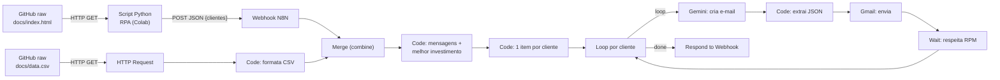

# Assistente de Investimentos com RPA + N8N + IA

Projeto da trilha DIO: um script de RPA (Python) coleta clientes de uma página HTML e os envia para um workflow N8N via Webhook. O N8N cruza cada cliente com as opções de investimento do seu perfil, e um agente de IA (Gemini) redige um e-mail personalizado, enviado pelo Gmail.

> **Repositório (fork):** `https://github.com/LucioCardoso/DIO_Assistente_Investimentos_RPA_N8N`
> 
> **Repositório original:** `https://github.com/digitalinnovationone/dio-lab-assistente-investimentos-rpa-n8n/)`
> 
> **Data da execução de validação:** 24/10/2026

---

## 1. Checklist de entregáveis

| # | Entregável | Status | Onde está |
|---|-----------|--------|-----------|
| 1 | Repositório forkado com o workflow N8N implementado | ☑ | link do fork acima |
| 2 | Workflow N8N exportado completo (com LLM Gemini) | ☑ | seção 4.3  / `n8n/Assistente RPA.json` |
| 3 | Script de RPA integrado ao Webhook do N8N | ☑ | seção 4.1 / `rpa/extrair_clientes.ipynb` |
| 4 | Print do fluxo de ponta a ponta | ☑ | seção 8 / `evidencias/Assistente RPA - Execução Completa.png` |
| 5 | Integração com Agente de IA no N8N | ☑ | seção 5 / `n8n/Assistente RPA.json` |
| 6 | Mensagens geradas dinamicamente via LLM | ☑ | seções 5 e 8 |
| 7 | Documentação explicando as decisões técnicas | ☑ | seção 6 |

---

## 2. Arquitetura



Fluxo resumido:

1. O **RPA** lê a tabela `#clientes` do `index.html` e envia `{"clientes": [...]}` ao Webhook.
2. O N8N baixa o `data.csv` (perfil, produto, mínimo, rentabilidade) e o converte em objetos.
3. O **Merge** junta clientes e investimentos em um único item.
4. Um **Code** escolhe a melhor opção para cada cliente e gera mensagens estáticas (a base da versão sem IA).
5. Outro **Code** transforma o resultado em **um item por cliente**.
6. Um **Loop** processa um cliente por vez: o **Gemini** escreve o e-mail, um **Code** extrai o JSON, o **Gmail** envia e um **Wait** controla o ritmo das chamadas.
7. Ao terminar, o **Respond to Webhook** devolve a resposta ao RPA.

---

## 3. Estrutura sugerida do repositório

```
.
├── docs/
│   ├── index.html                # tabela de clientes (fonte do RPA)
│   └── data.csv                  # opções de investimento por perfil
├──  evidencias/
│   ├── Assistente RPA - Execução Completa.png
│   └── Email*                # um print por e-mail enviado (seção 8)
├── n8n/
│   ├── Assistente RPA.json       # versão completa com agente IA (Gemini)
│   └── Code*.js                  # scripts dos nós Code
├── rpa/
│   └── extrair_clientes.ipynb    # script Python (RPA)
└── README.md                     # Documentação Projeto
```

---

## 4. Componentes

### 4.1 Script de RPA (Python / Google Colab)

Lê o HTML, extrai a tabela de clientes e envia ao Webhook do N8N. O host do N8N está mascarado neste documento (`<MEU_HOST>`).

```python
# Importação das bibliotecas necessárias
import requests
from bs4 import BeautifulSoup

# Links externos
URL_PAGINA = "https://raw.githubusercontent.com/LucioCardoso/DIO_Assistente_Investimentos_RPA_N8N/main/docs/index.html"
N8N_WEBHOOK = "https://<MEU_HOST>.ts.net:8443/webhook-test/clientes"

# 1) Baixar a página
html = requests.get(URL_PAGINA, timeout=30).text

# 2) Ler a tabela de clientes
soup = BeautifulSoup(html, "html.parser")
linhas = soup.select("#clientes tbody tr")

clientes = []

for linha in linhas:
    colunas = linha.find_all("td")
    cliente = {
        "nome":  colunas[0].get_text(strip=True),
        "email": colunas[1].get_text(strip=True),
        "saldo": colunas[2].get_text(strip=True),
        "perfil": colunas[3].get_text(strip=True),
    }
    clientes.append(cliente)

# 3) Mostrar o resultado
print("Clientes encontrados:", len(clientes))
print("Exemplo 1º cliente:", clientes[0] if clientes else "nenhum")
for cliente in clientes:
    print(cliente)

# 4) Enviar para o N8N
payload = {"clientes": clientes}
resp = requests.post(
    N8N_WEBHOOK,
    json=payload,
    headers={"Content-Type": "application/json"},
    timeout=300
)

print("Status:", resp.status_code)
print("Headers:", dict(resp.headers))
print("Resposta:", resp.text)
```

**Saída da execução (trecho):**

```
Clientes encontrados: 10
Exemplo 1º cliente: {'nome': 'Ana Silva', 'email': 'ana@email.com', 'saldo': 'R$ 12.500,00', 'perfil': 'Conservador'}
{'nome': 'Ana Silva', 'email': 'ana@email.com', 'saldo': 'R$ 12.500,00', 'perfil': 'Conservador'}
{'nome': 'Bruno Lima', 'email': 'bruno@email.com', 'saldo': 'R$ 3.200,00', 'perfil': 'Moderado'}
{'nome': 'Carla Souza', 'email': 'carla@email.com', 'saldo': 'R$ 28.900,00', 'perfil': 'Arrojado'}
{'nome': 'Daniel Oliveira', 'email': 'daniel@email.com', 'saldo': 'R$ 850,00', 'perfil': 'Conservador'}
{'nome': 'Elena Rodrigues', 'email': 'elena@email.com', 'saldo': 'R$ 45.000,00', 'perfil': 'Arrojado'}
{'nome': 'Felipe Santos', 'email': 'felipe@email.com', 'saldo': 'R$ 7.800,00', 'perfil': 'Moderado'}
{'nome': 'Gabriela Costa', 'email': 'gabriela@email.com', 'saldo': 'R$ 1.500,00', 'perfil': 'Conservador'}
{'nome': 'Henrique Alves', 'email': 'henrique@email.com', 'saldo': 'R$ 22.300,00', 'perfil': 'Moderado'}
{'nome': 'Isabela Martins', 'email': 'isabela@email.com', 'saldo': 'R$ 500,00', 'perfil': 'Conservador'}
{'nome': 'João Pereira', 'email': 'joao@email.com', 'saldo': 'R$ 15.000,00', 'perfil': 'Arrojado'}
Status: 200
Resposta: {"id":"1a16f7326bb806a9","threadId":"1a16f7326bb806a9","labelIds":["UNREAD","SENT","INBOX"]}
```

`Status: 200` e a resposta com `labelIds` contendo `SENT` confirmam que o workflow rodou até o envio pelo Gmail.

### 4.2 Nós do workflow N8N

| Nó | Tipo | Função |
|----|------|--------|
| Obtém dados dos clientes | Webhook (POST `/clientes`) | Recebe `body.clientes` do RPA |
| Obtém opções de investimento por perfil | HTTP Request (GET) | Baixa o `data.csv` do GitHub (raw) |
| Formata opções de investimento e perfil | Code (JS) | Converte o CSV em lista de objetos |
| Combina dados clientes e opções investimento | Merge (combine) | Junta clientes e investimentos |
| Mensagens e melhor investimento para cliente | Code (JS) | Escolhe o produto por perfil e saldo; gera as mensagens estáticas |
| Resultado único para um item por cliente | Code (JS) | Gera 1 item por cliente com os campos usados pelo LLM |
| Loop por cliente | Loop Over Items (batch 1) | Processa um cliente por vez |
| Cria e-mail personalizado | Google Gemini (Message a Model) | Gera `subject`, `text_body` e `html_body` |
| Extrair JSON e anexar e-mail | Code (JS) | Faz o parse do JSON do modelo e anexa `email_to` |
| Envia e-mail para o cliente | Gmail (Send a message) | Envia o e-mail em HTML |
| Espera para não exceder RPM Gemini | Wait (`<N>` s) | Pausa entre chamadas ao Gemini |
| Resposta ao Webhook | Respond to Webhook | Devolve a resposta ao RPA |

📷 **Print do workflow executado com sucesso:** 

#### Código: "Formata opções de investimento e perfil"

```javascript
// Pega o .csv como texto vindo do HTTP Request
const csvRaw = $json.data ?? $json.body ?? $json;
const text = (typeof csvRaw === "string") ? csvRaw : JSON.stringify(csvRaw);

const lines = text.split(/\r?\n/).map(l => l.trim()).filter(Boolean);
const headers = lines[0].split(",").map(h => h.trim());

const investimentos = lines.slice(1).map(line => {
  const cols = line.split(",").map(c => c.trim());
  const obj = {};
  headers.forEach((h, i) => obj[h] = cols[i] ?? "");

  // normaliza mínimo para número
  obj.minimo = Number(String(obj.minimo).replace(/[^\d]/g, "")) || 0;

  return obj;
});

return [{ json: { investimentos } }];
```

#### Código: "Mensagens e melhor investimento para cliente"

```javascript
// Entrada: 1 item vindo do Merge (clientes do Webhook + investimentos do CSV)
const dados = $input.first().json;

const clientes = dados.body?.clientes ?? dados.clientes;
const investimentos = dados.investimentos;

if (!Array.isArray(clientes) || !Array.isArray(investimentos)) {
  throw new Error("Esperado 'body.clientes' e 'investimentos' no item do Merge. Verifique o Merge e o Code anterior.");
}

// Helpers
const norm = s => String(s ?? "").trim().toLowerCase()
  .normalize("NFD").replace(/[\u0300-\u036f]/g, "");

// "R$ 12.500,00" -> 12500
const parseSaldo = txt =>
  Number(String(txt ?? "").replace(/[^\d,]/g, "").replace(",", ".")) || 0;

// 1000 -> "R$ 1.000,00"
const brl = n =>
  Number(n).toLocaleString("pt-BR", { style: "currency", currency: "BRL" })
    .replace(/\u00a0/g, " ");

const escolheAleatorio = arr => arr[Math.floor(Math.random() * arr.length)];

// Processamento
const resultados = clientes.map(c => {
  const saldo = parseSaldo(c.saldo);
  const opcoes = investimentos.filter(i => norm(i.perfil) === norm(c.perfil));
  const elegiveis = opcoes.filter(i => Number(i.minimo) <= saldo);

  let recomendacao = null;
  let motivo;

  if (elegiveis.length) {
    // maior mínimo que o saldo comporta
    recomendacao = elegiveis.reduce((a, b) => Number(b.minimo) > Number(a.minimo) ? b : a);
    motivo = "saldo_ok";
  } else if (opcoes.length) {
    // nenhuma opção cabe no saldo: sugere a mais acessível
    recomendacao = opcoes.reduce((a, b) => Number(b.minimo) < Number(a.minimo) ? b : a);
    motivo = "saldo_insuficiente";
  } else {
    motivo = "perfil_sem_produto";
  }

  let mensagens = [];
  if (recomendacao) {
    const prod = `**${recomendacao.produto}**`;
    const min = brl(recomendacao.minimo);
    const sal = brl(saldo);
    const rent = recomendacao.rentabilidade;

    if (motivo === "saldo_ok") {
      mensagens = [
        `Olá ${c.nome}! Pelo seu perfil (${c.perfil}), uma boa opção é ${prod} (mínimo ${min}). Com seu saldo atual (${sal}), você já consegue investir. Rentabilidade: ${rent}.`,
        `Oi ${c.nome}! Recomendação para perfil ${c.perfil}: ${prod} (mínimo ${min}). Seu saldo (${sal}) já atende o mínimo. Rentabilidade: ${rent}.`,
        `${c.nome}, indo direto ao ponto: para o perfil ${c.perfil}, ${prod} (mínimo ${min}). Você tem ${sal}, então dá pra aplicar. Rentabilidade: ${rent}.`
      ];
    } else {
      const falta = brl(Number(recomendacao.minimo) - saldo);
      mensagens = [
        `Olá ${c.nome}! Pelo seu perfil (${c.perfil}), a opção mais acessível é ${prod} (mínimo ${min}). Seu saldo (${sal}) ainda não atinge o mínimo: faltam ${falta}. Rentabilidade: ${rent}.`,
        `Oi ${c.nome}! Para perfil ${c.perfil}, a entrada mais baixa é ${prod} (mínimo ${min}). Com ${sal} ainda faltam ${falta}. Rentabilidade: ${rent}.`,
        `${c.nome}, para o perfil ${c.perfil}, ${prod} exige ${min}. Seu saldo é ${sal}, faltam ${falta} para começar. Rentabilidade: ${rent}.`
      ];
    }
  }

  return {
    nome: c.nome,
    email: c.email,
    perfil: c.perfil,
    saldo_texto: c.saldo,
    saldo_num: saldo,
    recomendacao: recomendacao
      ? {
          perfil: recomendacao.perfil,
          produto: recomendacao.produto,
          minimo: Number(recomendacao.minimo),
          rentabilidade: recomendacao.rentabilidade
        }
      : null,
    motivo,
    mensagens,
    mensagem_escolhida: mensagens.length ? escolheAleatorio(mensagens) : ""
  };
});

return [{
  json: {
    ok: true,
    total_clientes: clientes.length,
    total_investimentos: investimentos.length,
    resultados
  }
}];
```

#### Código: "Resultado único para um item por cliente"

```javascript
// Entrada: 1 item vindo do "Code in JavaScript1" com o array 'resultados'
const resultados = $input.first().json.resultados;

if (!Array.isArray(resultados)) {
  throw new Error("Campo 'resultados' não encontrado ou não é um array. Verifique a saída do Code in JavaScript1.");
}

// "R$ 12.500,00" -> 12500
function parseBRL(valor) {
  if (!valor) return 0;
  const s = String(valor)
    .replace("R$", "")
    .replace(/\./g, "")
    .replace(",", ".")
    .replace(/[^\d.]/g, "")
    .trim();
  const n = Number(s);
  return Number.isFinite(n) ? n : 0;
}

// Retorna UM ITEM por cliente
return resultados.map(c => {
  const saldoNum = c.saldo_num ?? parseBRL(c.saldo_texto ?? c.saldo);

  return {
    json: {
      email_to: String(c.email ?? "").trim(),
      nome: String(c.nome ?? "").trim(),
      perfil: String(c.perfil ?? "").trim(),
      saldo_texto: c.saldo_texto ?? c.saldo ?? "",
      saldo_num: saldoNum,
      recomendacao: c.recomendacao ?? null,
      motivo: c.motivo ?? "",
      mensagem_base: c.mensagem_escolhida ?? c.mensagens?.[0] ?? ""
    }
  };
});
```

#### Código: "Extrair JSON e anexar e-mail"

```javascript
const raw = $json.content?.parts?.[0]?.text ?? "";
const limpo = raw.replace(/```json|```/g, "").trim();

let email;
try {
  email = JSON.parse(limpo);
} catch (e) {
  throw new Error("Resposta do Gemini não é JSON válido: " + limpo.slice(0, 200));
}

const origem = $('Loop por cliente').item.json;

return {
  json: {
    email_to: origem.email_to,
    nome: origem.nome,
    subject: email.subject,
    text_body: email.text_body,
    html_body: email.html_body
  }
};
```

### 4.3 Nó Gmail e e-mail de teste

**Foram usados os e-mails do próprio aluno como destinatário, e não os e-mails da lista de clientes.** Os endereços da tabela (`ana@email.com`, `bruno@email.com` etc.) são fictícios e inválidos: um envio real geraria devoluções (bounces) e não permitiria verificar o resultado. Para validar a lógica e o funcionamento do fluxo, o campo **To** do nó Gmail foi fixado no endereço do próprio aluno (`<MEU_EMAIL>`), e as 10 mensagens chegaram na mesma caixa de entrada.

O que continua sendo validado com essa configuração:

- a leitura dos clientes pelo RPA e o envio ao Webhook;
- a escolha do produto por perfil e saldo;
- a personalização de cada e-mail (nome, perfil, saldo, produto e mínimo do cliente correto no texto);
- o formato de saída do LLM, o parse do JSON e o envio em HTML.

Configuração do nó **Envia e-mail para o cliente**:

| Campo | Teste (usado nesta entrega) | Uso real |
|-------|------------------------------|----------|
| To | `<MEU_EMAIL>` (endereço fixo do aluno) | `{{ $json.email_to }}` |
| Subject | `{{ $json.subject }}` | `{{ $json.subject }}` |
| Email Type | HTML | HTML |
| Message | `{{ $json.html_body }}` | `{{ $json.html_body }}` |

Em produção, bastaria trocar o campo **To** pela expressão `{{ $json.email_to }}`, com e-mails reais e validados dos clientes, idealmente com consentimento para receber comunicações.

### 4.4 Workflow com mensagens estáticas (`n8n/Assistente RPA.json`)

A versão estática usa apenas as mensagens geradas pelo nó **Mensagens e melhor investimento para cliente** (três modelos de texto por situação, com uma sorteada em `mensagem_escolhida`). Ela é a mesma cadeia da seção 2 até o nó **Resultado único para um item por cliente**, sem Loop, Gemini, Extrair JSON e Wait. O campo `mensagem_base` é enviado direto no Gmail.

Observação: as mensagens estáticas contêm `**produto**` (markdown). Em e-mail de texto simples, os asteriscos aparecem literalmente; isso não ocorre na versão com LLM, que gera HTML.

---

## 5. Integração com Agente de IA (Gemini)

- **Nó:** Google Gemini (PaLM) → *Message a Model* (nome: "Cria e-mail personalizado")
- **Modelo:** `models/gemini-3.1-flash-lite`
- **Credencial:** API Key do Google AI Studio, criada exclusivamente para este projeto
- **Entrada:** um cliente por execução (nome, perfil, saldo, produto recomendado, mínimo, rentabilidade, motivo e mensagem base)
- **Saída:** JSON com `subject`, `text_body` e `html_body`, lido em `content.parts[0].text`

### Prompt

````
Escreva um e-mail curto em pt-BR para o cliente abaixo, sem prometer ganhos e sem garantias.

Cliente:
Nome: {{ $json.nome }}
Perfil: {{ $json.perfil }}
Saldo: {{ $json.saldo_texto }}

Recomendação:
Produto: {{ $json.recomendacao?.produto }}
Mínimo: {{ Number($json.recomendacao?.minimo).toLocaleString("pt-BR", { style: "currency", currency: "BRL" }) }}
Rentabilidade informada: {{ $json.recomendacao?.rentabilidade }}
Situação: {{ $json.motivo }}

Mensagem base (use apenas como referência de conteúdo; reescreva com suas palavras):
{{ $json.mensagem_base }}

Regras:
- Idioma: pt-BR.
- Tom: amigável e profissional.
- Tamanho: curto (até 8 linhas).
- Evitar: promessas de ganho, garantias, linguagem agressiva.
- Apresente o produto como sugestão informativa. A rentabilidade é uma referência do produto, nunca uma expectativa de retorno.
- Cite a rentabilidade exatamente como informada (ex.: "12.5%"), sem acrescentar período como "ao ano" ou "ao mês".
- Se a situação for "saldo_insuficiente", diga com delicadeza que o saldo ainda não atinge o mínimo e não pressione.
- Não invente produtos, taxas, prazos ou valores além dos informados acima.
- Não use markdown (sem **asteriscos**) no text_body; no html_body use apenas <p> e <strong>.
- Encerre convidando o cliente a responder o e-mail para conversar, e assine como "Equipe de Investimentos".

Formato de saída: responda SOMENTE com JSON válido, sem markdown e sem ```:
{
  "subject": "...",
  "text_body": "...",
  "html_body": "..."
}
````

### Evolução do prompt

No primeiro teste, o modelo escreveu que a rentabilidade era de "12,5% **ao ano**", embora o dado de origem seja apenas `12.5%`, sem período. A regra "Cite a rentabilidade exatamente como informada" foi adicionada para impedir que o modelo invente prazos, o que contraria a regra "não invente prazos ou valores".

---

## 6. Decisões técnicas

| Decisão | Motivo |
|---------|--------|
| Ler o HTML e o CSV via URL **raw** do GitHub (`raw.githubusercontent.com/.../docs/...`) | A URL da interface do repositório devolve a página do GitHub, sem a tabela `#clientes`; a URL raw devolve o arquivo original e não depende de GitHub Pages |
| Parse do CSV com `split(",")` | O arquivo é simples, sem aspas nem vírgulas internas. Se isso mudar, é preciso um parser de CSV |
| Conversão do saldo `"R$ 12.500,00"` → `12500` (mantém dígitos e vírgula, troca a vírgula por ponto) | Trata corretamente o ponto de milhar e os centavos; remover só os não-dígitos transformaria 12.500,00 em 1250000 |
| Produto escolhido: **maior mínimo que o saldo comporta** dentro do perfil | Regra simples e explicável. Em empate de mínimos, vale o primeiro produto da lista no CSV |
| Campo `motivo` (`saldo_ok`, `saldo_insuficiente`, `perfil_sem_produto`) | Permite ao LLM ajustar o tom sem lógica adicional no workflow |
| Mensagens estáticas geradas antes do LLM | Garantem uma versão funcional sem IA (entregável 2) e servem de **mensagem base** para o modelo |
| Mensagem base sorteada entre 3 variações | Dá variedade ao texto de referência; o resultado final do LLM também varia entre execuções |
| Um item por cliente + **Loop Over Items** (batch 1) | Cada cliente tem seu e-mail; o loop controla o ritmo das chamadas ao modelo |
| Nó **Wait** dentro do loop | O free tier do Gemini limita as requisições por minuto; a primeira execução em paralelo gerou erro 429 (cota excedida) |
| API Key exclusiva para o projeto | A chave anterior já tinha a cota esgotada por outros usos |
| Modelo **Flash-Lite** | Mais rápido e com limites mais folgados no free tier |
| Prompt exige **JSON puro**; o Code remove cercas ```` ```json ```` antes do `JSON.parse` | Modelos às vezes embrulham o JSON em markdown; se vier inválido, o erro mostra o início da resposta |
| Regras no prompt: sem promessa de ganho, sem garantia, sem inventar valores, rentabilidade como referência | Comunicação sobre investimentos é sensível; reduz o risco de texto inadequado ou enganoso |
| Mínimo formatado em reais dentro do prompt (`toLocaleString("pt-BR")`) | O modelo recebe o valor já no formato que deve aparecer no e-mail |
| E-mail do próprio aluno como destinatário nos testes | Os endereços da lista são fictícios (ver seção 4.3) |
| `timeout=300` no RPA | O workflow leva alguns minutos por causa do intervalo entre chamadas ao Gemini |
| Webhook de teste (`/webhook-test/`) durante o desenvolvimento | Permite ver os dados de cada nó no editor; em produção, ativar o workflow e usar `/webhook/` |

---

## 7. Como executar

1. **N8N:** importe `n8n/Assistente RPA.json`.
2. **Credenciais:** configure Google Gemini (API Key) e Gmail (OAuth2). O JSON exportado guarda só a referência às credenciais, não os segredos.
3. **Destinatário:** para teste, fixe o campo *To* do nó Gmail no seu e-mail; para uso real, `{{ $json.email_to }}`.
4. **Teste:** clique em *Execute workflow* no nó Webhook (URL `/webhook-test/clientes`).
5. **RPA:** rode o script Python logo em seguida, no Colab ou localmente.
6. **Produção:** ative o workflow (*Active*) e use a URL `/webhook/clientes` no script.

---

## 8. Evidências

### 8.1 Fluxo de ponta a ponta

- Saída do script Python (`Status: 200`): `rpa/extrair_clientes.ipynb`
- Workflow executado com todos os nós verdes: `evidencias/Assistente RPA - Execução Completa.png`

### 8.2 E-mails enviados: personalização por cliente

Cada e-mail abaixo foi gerado pelo Gemini a partir dos dados do cliente e enviado pelo Gmail (para o e-mail de teste, ver seção 4.3). A coluna "Produto esperado pela regra" é o resultado da regra de negócio aplicada ao `data.csv`, para comparar com o texto que o modelo escreveu.

| # | Cliente | Perfil | Saldo | Produto esperado pela regra | Mínimo | Rentabilidade |
|---|---------|--------|-------|-----------------------------|--------|---------------|
| 1 | Ana Silva | Conservador | R$ 12.500,00 | CDB Liquidez Diária | R$ 1.000,00 | 12.5% |
| 2 | Bruno Lima | Moderado | R$ 3.200,00 | CDB Prefixado | R$ 1.000,00 | 14.0% |
| 3 | Carla Souza | Arrojado | R$ 28.900,00 | Fundo de Ações | R$ 10.000,00 | Variável |
| 4 | Daniel Oliveira | Conservador | R$ 850,00 | Tesouro Selic | R$ 500,00 | 13.0% |
| 5 | Elena Rodrigues | Arrojado | R$ 45.000,00 | Fundo de Ações | R$ 10.000,00 | Variável |
| 6 | Felipe Santos | Moderado | R$ 7.800,00 | Fundo Multimercado | R$ 5.000,00 | 16.0% |
| 7 | Gabriela Costa | Conservador | R$ 1.500,00 | CDB Liquidez Diária | R$ 1.000,00 | 12.5% |
| 8 | Henrique Alves | Moderado | R$ 22.300,00 | Fundo Multimercado | R$ 5.000,00 | 16.0% |
| 9 | Isabela Martins | Conservador | R$ 500,00 | Tesouro Selic | R$ 500,00 | 13.0% |
| 10 | João Pereira | Arrojado | R$ 15.000,00 | Fundo de Ações | R$ 10.000,00 | Variável |

#### 1. Ana Silva (Conservador, R$ 12.500,00)


#### 2. Bruno Lima (Moderado, R$ 3.200,00)


#### 3. Carla Souza (Arrojado, R$ 28.900,00)


#### 4. Daniel Oliveira (Conservador, R$ 850,00)


#### 5. Elena Rodrigues (Arrojado, R$ 45.000,00)


#### 6. Felipe Santos (Moderado, R$ 7.800,00)


#### 7. Gabriela Costa (Conservador, R$ 1.500,00)


#### 8. Henrique Alves (Moderado, R$ 22.300,00)


#### 9. Isabela Martins (Conservador, R$ 500,00)


#### 10. João Pereira (Arrojado, R$ 15.000,00)


### 8.3 Síntese da personalização (preencher após inserir os prints)

- **Adequação ao perfil:** `<como o texto muda entre Conservador, Moderado e Arrojado>`
- **Variação de linguagem entre e-mails:** `<aberturas, estrutura e tom diferentes para clientes com o mesmo perfil>`
- **Cumprimento das regras:** `<sem promessa de ganho, sem garantias, rentabilidade citada como informada, assinatura "Equipe de Investimentos">`
- **Falhas encontradas, se houver:** `<ex.: prazo inventado, valor incorreto>`

---

## 9. Limitações e próximos passos

- Com os dados de exemplo, nenhum cliente cai em `saldo_insuficiente` (o menor saldo, R$ 500,00, ainda atende algum produto do perfil). Esse ramo do código e do prompt não foi exercitado; para testá-lo, basta reduzir o saldo de um cliente no `index.html`.
- O fluxo leva alguns minutos para 10 clientes por causa do intervalo entre chamadas ao Gemini. Com cota maior, o Wait pode ser reduzido.
- O parse do CSV não suporta campos com aspas ou vírgulas internas.
- O Respond to Webhook devolve a saída do último item do loop; um resumo (enviados e falhas) seria mais útil ao RPA.
- Tratar falhas por cliente (*Retry On Fail* e *Continue On Fail*) para que um erro de LLM ou Gmail não interrompa o lote.
- Validar o texto do e-mail antes do envio, por exemplo checando se não cita prazos ou taxas ausentes nos dados.
- Nunca versionar chaves de API ou credenciais; revisar o `workflow.json` e o script antes do commit (o host do N8N também é informação sensível em repositório público).
